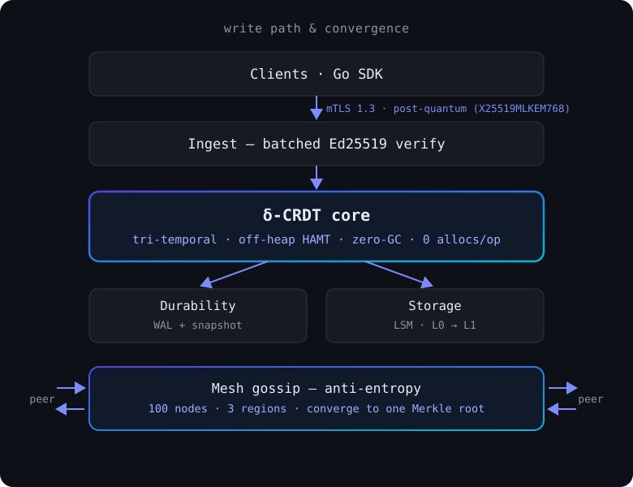

<div align="center">
  <picture>
    <source media="(prefers-color-scheme: dark)" srcset="docs/assets/logo-dark.svg">
    <source media="(prefers-color-scheme: light)" srcset="docs/assets/logo-light.svg">
    
  </picture>

  <h1>Sovereign Engine</h1>

  <p><strong>A leaderless database engine: multi-region writes that converge without coordination, post-quantum transport, and a zero-allocation CRDT core write path. Each measurement identifies its workload, hardware and source.</strong></p>

  <p>
    <a href="LICENSE"></a>
    <a href="https://go.dev"></a>
    <a href="https://go.dev"></a>
    <a href="https://github.com/hr18vk/sovereign/actions/workflows/gatekeeper.yml"></a>
    <a href="https://github.com/codespaces/new?hide_repo_select=true&ref=main&repo=hr18vk%2Fsovereign"></a>
  </p>
</div>

---

## What is this, in plain terms?

Sovereign Engine is a database engine: the layer that sits underneath almost every app and actually stores its data.

Applications often need to accept writes in several regions without making each write wait for a global leader. Sovereign explores a design that combines leaderless convergence, an off-heap CRDT core and post-quantum transport:

- **Measured core write path** — the in-process CRDT benchmark applies millions of operations per second without heap allocation. The signed receive path is benchmarked separately.
- **Converges without a leader** — writes from many places settle on the same answer without losing concurrent updates. A read can be briefly stale. The v0.1.0 receipt checked 100 node processes on three machines, one per AWS region. v0.2.0 adds three consecutive 1,000-node runs on 30 machines across three regions on 2026-11-06, alongside earlier attempts that missed the target.
- **Post-quantum key exchange** — peer and control listeners negotiate X25519MLKEM768 by default when both endpoints support it. Hybrid Ed25519 + ML-DSA-65 signatures are built and tested behind opt-in flags.

The evidence directory records the commands, machine details and output for the published runs so you can inspect them.

**Want the longer version, without the jargon?** [**What this is, in plain English**](https://sovereignengine.space/what-is-sovereign-engine) walks through the problem the engine solves, how it actually works, what every published number does and does *not* mean, and what isn't finished yet. No prior database knowledge assumed, and it ends with a glossary.

> **Status: research preview by one developer, not production ready.** This is a working, measured engine published early so the design and the numbers can be checked. No one outside the project has reproduced these results yet; see [docs/VERIFY.md](docs/VERIFY.md) for what it takes. See [Where it stands](#where-it-stands) for the current limits.

### Headline numbers

| Layer | Number | Conditions | Date | Receipt |
|:--|:--|:--|:--|:--|
| **CRDT core** | **68,278,197 ops/s** on 32 cores (gate threshold 50M ops/s) | `TestScalingGate` · c8g.8xlarge (Graviton4) · Go 1.26.1 | 2026-09-03 | [core-crucible.txt](https://github.com/hr18vk/sovereign/blob/v0.2.0/docs/evidence/core-crucible.txt) |
| **In-process receive path** | **5.7M–6.0M deltas/sec** on 32 cores (N=100–256; ceiling 12.5M–14.7M) | `BenchmarkBatchedVerifyParallel` · c8g.8xlarge (Graviton4) · Go 1.26.1 | 2026-09-15 | [ingest-ed25519.txt](https://github.com/hr18vk/sovereign/blob/v0.2.0/docs/evidence/ingest-ed25519.txt) |
| **Convergence (v0.2.0)** | 1,000 node processes on 30 machines (333/333/334 split) across us-east-1, eu-west-1, ap-southeast-2 agree in **2.906 s, 4.038 s, 3.823 s** after origin quiescence | `convergence-1000-node.txt` · 30× c7gd.8xlarge | 2026-11-06 | [convergence-1000-node.txt](https://github.com/hr18vk/sovereign/blob/v0.2.0/docs/evidence/convergence-1000-node.txt) |

Earlier 1,000-node runs missed the target; all 49 attempts are listed in [convergence-1000-node-attempts.tsv](https://github.com/hr18vk/sovereign/blob/v0.2.0/docs/evidence/convergence-1000-node-attempts.tsv).

## Why I built this

It bothered me that "pick two out of three" was treated as normal for something as basic as a database. So I tried to build one that doesn't make you choose.

Most of the work was not the parts that worked. A node's shutdown path unmapped its memory arena while background reclamation was still walking it, a use-after-free at the 68,278,197 ops/s core throughput. The write-ahead log held its lock across a blocking `fsync` and starved the very writes it was protecting. A seed node sat with one commit in flight for over 300 seconds, and the cause turned out to be a checkpoint flush sitting on the commit path; moving it off brought the same run down to 8.3 seconds. Each of those has a decision record with the root cause, the fix and the measurement, and the bigger ones are written up in the [post-mortem](docs/architecture/6_ENGINEERING_POST_MORTEM.md). The dead ends are where the engineering actually is.

## Who needs this

Anywhere data gets written in more than one place and losing a write isn't acceptable:

- **Multi-region applications** that pay a cross-ocean round trip on every write, or quietly accept last-writer-wins and the updates it throws away.
- **Audited domains** like finance, insurance, healthcare and logistics, which have to answer "what did we believe, and when" months after the fact, not just "what is true now".
- **Edge and offline-first fleets** where nodes go dark for hours and have to rejoin without a person reconciling anything by hand.

Those are one problem wearing three hats. The usual answer is a stack of separate systems with a reconciliation job in the middle that nobody entirely trusts. This engine is an attempt to make it one system, where merging is arithmetic and there is nothing left to reconcile.

## Why it's different

Five design choices, each with its real status stated rather than implied:

| | |
|:--|:--|
| **Tri-temporal CRDT state** | Every fact carries `system × valid × assertion` time, so you can ask "what did we know, and when." Concurrent writers converge without a leader or a coordinator. XTDB is bitemporal, Datomic keeps transaction time, and neither of them converges without coordination; all three clocks *plus* leaderless convergence is the combination I couldn't find anywhere else. |
| **H3 and system-time secondary index, opt-in** | With `--secondary-index`, the engine indexes caller-supplied H3 cells and system-time values on writes and recovery, then serves current-state queries through `/v1/querybyh3` and `/v1/querybysystime`. Coordinate-to-H3 conversion is not wired into the write path, and the index treats cell values as opaque identifiers rather than inferring geographic validity. |
| **Post-quantum transport, on by default** | Peer and control listeners negotiate X25519MLKEM768 by default when both endpoints support it, and a test asserts the *negotiated* curve ID rather than trusting the config. Hybrid Ed25519 + ML-DSA-65 signing is built and tested, with both signatures required to accept a frame, but it stays **opt-in** (`--hybrid-sign`, `--hybrid-verify`) so the default wire format remains byte-identical for peers that don't have it. |
| **Zero-GC CRDT core** | The core write path does **0 allocations per op**, because state lives in an off-heap arena the Go garbage collector never walks. This does not include signature verification, envelope decoding or network ingest. |
| **Cedar authorization** | **Benchmark only**. Cedar policy evaluation is implemented and benchmarked (`pkg/authorization/cedar_bench_test.go`), but no Cedar policy is enforced on any API path. |

<p align="center"></p>

---

## The measurement that changed the design

The hot path is a lock-free stack, so the obvious contention point is the stack head. I sharded it. Throughput barely moved.

It took me a while to see why. Every core refilling its local cache was still issuing a compare-and-swap against one global free-list head, and that single word sat on one cache line that all 32 cores were now fighting over. I hadn't removed the contention, I'd relocated it. The cores weren't short of memory bandwidth; they were serializing on cache coherence, and from a profile that only shows you elapsed time the two look identical.

The measured cost of that one shared line is **1.1M ops/s at 32 cores, which is 1.6% parallel efficiency**. Dispersing the locus across 64 home-shard lines took the same engine to **50.7M–68.3M ops/s**, roughly 46× to 62×.

Two things came out of it. Every contended atomic now gets a 128-byte stride of its own, checked by layout tests, and I place that padding by hand because an automatic formatter has silently destroyed it before. And the benchmark that records the 1.1M failure is still in the tree, skipped, with the reason and the number written into the skip, because deleting it would let someone later assume the old design was merely slower. The full account is in [the post-mortem](docs/architecture/6_ENGINEERING_POST_MORTEM.md).

## The measured numbers

> **Keep the measurement layers separate.** The CRDT **core** number is an in-process data-structure test with no crypto, network, TLS or disk. The **in-process receive-path** benchmark verifies one Ed25519 signature per frame, then decodes the envelope and merges each delta; it does not include a socket, TLS or disk. Multi-region convergence is a third measurement. None of these numbers substitutes for another.

| Layer | Number | Where it's from |
|:--|:--|:--|
| **CRDT core** | **68,278,197 ops/s** on 32 cores (gate threshold 50M ops/s) | `TestScalingGate` · c8g.8xlarge (Graviton4) · Go 1.26.1 · [core-crucible.txt](https://github.com/hr18vk/sovereign/blob/v0.2.0/docs/evidence/core-crucible.txt) |
| **In-process receive path** | **5.7M–6.0M deltas/sec** on 32 cores (N=100–256; ceiling 12.5M–14.7M) | `BenchmarkBatchedVerifyParallel` · measured 2026-09-15 · [ingest-ed25519.txt](https://github.com/hr18vk/sovereign/blob/v0.2.0/docs/evidence/ingest-ed25519.txt) |
| **Hot-path allocations** | **0 allocs/op, 0 B/op** | `TestHotPathZeroAllocations` · [zero-alloc.txt](https://github.com/hr18vk/sovereign/blob/v0.2.0/docs/evidence/zero-alloc.txt) |
| **Convergence (v0.1.0)** | 100 node processes on 3 machines (one per region) agree in **8.95s** on the published run; six of seven logged runs 6.6–8.7s, one miss at 10.15s | `convergence-100-node.txt` · 3× c7gd.8xlarge (Graviton3) · integrity checks on · the seven-run table is in [ADR-0050](https://github.com/hr18vk/sovereign/blob/v0.2.0/docs/architecture/adr/0050_checkpoint_decouple_delta.md) |
| **Convergence (v0.2.0)** | 1,000 node processes on 30 machines (333/333/334 split) across us-east-1, eu-west-1, ap-southeast-2 agree in **2.906 s, 4.038 s, 3.823 s** after origin quiescence on 2026-11-06; three fault drills passed; 49 full-scale attempts including earlier misses are listed in [convergence-1000-node-attempts.tsv](https://github.com/hr18vk/sovereign/blob/v0.2.0/docs/evidence/convergence-1000-node-attempts.tsv) | `convergence-1000-node.txt` · 30× c7gd.8xlarge · [convergence-1000-node-runs.tsv](https://github.com/hr18vk/sovereign/blob/v0.2.0/docs/evidence/convergence-1000-node-runs.tsv) |

The exact command, machine and output are in [docs/evidence/](docs/evidence/). The local scripts below re-run the single-machine checks; they do not recreate the multi-region fleet run.

### How it compares

The three measurement layers above — core, receive path, and multi-region convergence — are distinct and not interchangeable. External system numbers are not reproduced here; see the [benchmark comparison page](https://sovereignengine.space/benchmark-comparison) for methodology and sources.

---

## Try it

The published measurements were taken on Linux/arm64. Building from source requires Linux, Go 1.26.1, a C toolchain and the jemalloc headers. On Debian or Ubuntu, install dependencies first:

```bash
sudo apt-get install -y build-essential libjemalloc-dev   # gcc for the jemalloc CGO bridge, and jemalloc itself
```

The `reproduce.sh` script records host details (UTC, kernel, arch, Go, jemalloc, commit) and, when running on EC2, queries the instance metadata service at `169.254.169.254` (IMDSv2) to record the instance type and region. This request times out after one second and is silently skipped outside EC2. The script then runs the single-host gates and benchmarks and saves a transcript. It does not re-run the multi-region fleet measurement.

```bash
git clone https://github.com/hr18vk/sovereign.git
cd sovereign
go build ./...                             # builds the engine
go test ./pkg/sync/ -run TestHotPathZeroAllocations -v  # checks the core write path
./scripts/reproduce.sh                     # local gates and benchmarks, with a saved transcript
```

That `TestHotPathZeroAllocations` command checks the allocation behaviour. On a clean tree it prints:

```
--- PASS: TestHotPathZeroAllocations (0.00s)
ok      github.com/hr18vk/sovereign/pkg/sync    0.006s
```

A second script runs a local mesh. `local-mesh.sh` starts three nodes on one machine:

```bash
CRASH=1 ./scripts/local-mesh.sh   # converge, kill -9 the origin, recover from the WAL
```

Fewer cores mean lower absolute numbers. The scaling gate needs eight or more cores and asserts 50M ops/s at its top tier, so a small machine can fail it on throughput alone; the transcript records the result.

Or open a ready-to-run [GitHub Codespace](https://github.com/codespaces/new?hide_repo_select=true&ref=main&repo=hr18vk%2Fsovereign), where the dependencies are already installed.

The SDK path (dev CA, node identity, the mTLS control port and a client example) is in [docs/sdk-quickstart.md](docs/sdk-quickstart.md). The 32-core benchmark (`scripts/benchmark.sh`) installs the exact Go 1.26.1 toolchain and runs the scaling gate, which asserts 50M ops/s at its top tier. Reproducing the headline core measurement requires the named ARM64 machine.

---

## Where it stands

**Research preview, not production-ready.** The engine and its measurements are published so the design can be inspected, but the safeguards and interfaces needed for production use are not finished. Don't trust it with data you can't afford to lose.

| Capability | Status |
|:--|:--|
| Mesh — 100 node processes on 3 machines (one per region), mTLS | Tested in the published v0.1.0 run |
| Mesh — 1,000 node processes on 30 machines (333/333/334 split), mTLS | Three clean runs and three fault drills on 2026-11-06 |
| Convergence — 10K keys across the fleet (v0.1.0) | Met on the published run (8.95s); six of seven logged runs 6.6–8.7s, one miss at 10.15s |
| Convergence — 10K keys across the fleet (v0.2.0) | Three consecutive runs converged in 2.906 s, 4.038 s, 3.823 s after origin quiescence; all 1,000 state fingerprints equal in each run |
| Crash recovery | Tested: the root matches again after a kill |
| Durability — WAL fsync per batch | Held on the published runs |
| Convergence tail (last 1–2 of 100/1000 nodes) | Still hardening; one published v0.1.0 run in seven missed the target |
| Production PKI / HSM · io_uring · gRPC API | Planned |
| Known allocator issue | `pushFreeNode` stores the fixed-size HAMT node free-list link in the first eight bytes of a dead `HamtNode`, overlapping `refCount` and `bitmap`, instead of the dedicated `nextFree` field at offset 64. The write overwrites node metadata and creates a reclamation and reuse hazard. This release retains that defect; the correction is planned for the next release. The current layout is documented in [the struct-alignment notes](docs/internals/STRUCT_ALIGNMENT.md). |

The [verification page](docs/VERIFY.md) describes the evidence tier behind each row.

### Platform status

The pre-publication platform check on 2026-11-21 tested native Linux arm64 and emulated Linux amd64 builds and complete short-test invocations:

| Platform | Build | Short tests | Build duration | Test duration |
|:--|:--|:--|:--|:--|
| Native Linux arm64, Go 1.26.1 | PASS, exit 0 | FAIL, exit 1 | 20 s | 409 s |
| Emulated Linux amd64, Ubuntu 24.04.5, Go 1.26.1 | PASS, exit 0 | FAIL, exit 1 | 357 s | 677 s |

**Native arm64 failures:**
- `pkg/durability`: `TestCheckpointWalkPinnedAgainstState` → `panic: HamtArena: OOM - arena exhausted (variable alloc)`
- `sdk/sovereign`: `TestClientGetOnPeerReturnsDigestNotValue` → `did not converge in 20 rounds` (known SDK failure)

**Emulated amd64 failures:**
- Ten packages failed with `signal: segmentation fault (core dumped)`: `cmd/sovereign-node`, `internal/database`, `internal/index`, `internal/network`, `internal/transport`, `pkg/durability`, `pkg/mesh`, `pkg/receive`, `pkg/security/fuzz`, `sdk/sovereign`
- `pkg/attribution`: `TestEnvelope_HopBoundExceededZeroVerify` → `O(1) depth check took 12.754µs (must be sub-microsecond, zero Verify)`
- `pkg/metrics`: `TestIngestLatencyRecorded` → `the 1e-06 bucket has no early-rejection samples`

The emulated result does not establish behavior on native amd64 hardware or a root cause for the segmentation faults. Neither complete short-test invocation passed. These results do not support a claim of a green test suite on either platform. Full receipt: [platform-checks-2026-11-21.txt](https://github.com/hr18vk/sovereign/blob/v0.2.0/docs/evidence/platform-checks-2026-11-21.txt).

---

## Documentation map

- **Check the claims:** `docs/VERIFY.md` and the [published receipts](docs/evidence/).
- **Understand the design:** [architecture documents](docs/architecture/), the [engineering post-mortem](docs/architecture/6_ENGINEERING_POST_MORTEM.md), and [struct-alignment notes](docs/internals/STRUCT_ALIGNMENT.md).
- **Trace a decision:** the [ADR index](docs/architecture/adr/) records root causes, changes and measured results (71 ADRs).
- **Use the SDK:** [docs/sdk-quickstart.md](docs/sdk-quickstart.md).
- **See release changes:** `CHANGELOG.md`.
- **Read the project policies:** [SECURITY.md](SECURITY.md), [CONTRIBUTING.md](CONTRIBUTING.md), and [STYLE.md](STYLE.md).
- **Browse the documentation:** the [developer portal](https://sovereignengine.space).

> **On the name.** The original codename was *supremum*, the mathematical least-upper-bound, which is exactly what a CRDT merge computes. The project and the Go module path are **Sovereign Engine**; the codename survives only in the runtime interfaces used by published logs and scripts (`supremum_*` metrics and `SUPREMUM_*` environment knobs). The style document is now `STYLE.md`.

## About the author

Built by **Harsh Rawat**, working solo. The architecture, the design decisions and the failures above are mine, and every number in this repo is one I ran and read myself.

## License

Source-available under the [Business Source License 1.1](LICENSE) — Licensor **Harsh Rawat** ("Sovereign Engine" is the project name, not a company). Non-Production Use is free; Production Use needs a written grant until the applicable Change Date, when that version converts to Apache License 2.0. The v0.1.0 Change Date remains **2029-08-15**. The v0.2.0 Change Date is four years after its actual publication date. To ask about a production-use grant, contact the Licensor through his [GitHub profile](https://github.com/hr18vk).